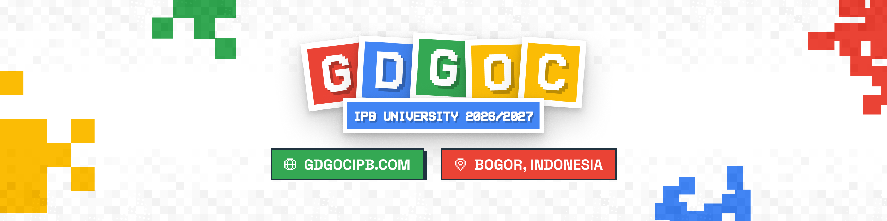

  <a href="https://www.gdgocipb.com">
    <picture>
      <source media="(prefers-color-scheme: dark)" srcset="https://raw.githubusercontent.com/gdgoc-ipb-university/.github/main/profile/banner-dark.png">
      
    </picture>
  </a>

# GDGoC IPB University

Google Developer Group on Campus IPB University: komunitas mahasiswa Bogor untuk belajar coding, UI/UX, dan AI lewat sesi praktik, proyek tim, dan kompetisi.

## Program

| Program | Untuk siapa | Isinya |
| --- | --- | --- |
| [GDGoC Catalyst](https://www.gdgocipb.com/program/catalyst) | Siswa SMK dan mahasiswa dari kampus mana pun | Bootcamp Software Development gratis dengan peran Hacker, Hipster, dan Hustler |
| [Tech League](https://league.gdgocipb.com) | Tim mahasiswa se-Indonesia | Kompetisi nasional untuk Software Development, UI/UX Design, dan Business Plan |
| [Tech Support](https://www.gdgocipb.com/program/tech-support) | Member GDGoC IPB | Mentor untuk persiapan kompetisi eksternal, dari ideasi sampai mock judging |

## Repositori

- [`gdgoc-web`](https://github.com/gdgoc-ipb-university/gdgoc-web): kode [gdgocipb.com](https://www.gdgocipb.com) dan [league.gdgocipb.com](https://league.gdgocipb.com), dibangun dengan Next.js dan Convex.

## Bergabung

- [Cara bergabung](https://www.gdgocipb.com/bergabung)
- [Halaman chapter di Google Developer Groups](https://gdg.community.dev/gdg-on-campus-ipb-university-bogor-indonesia/)
- [Instagram @gdgoc.ipb](https://www.instagram.com/gdgoc.ipb/)
